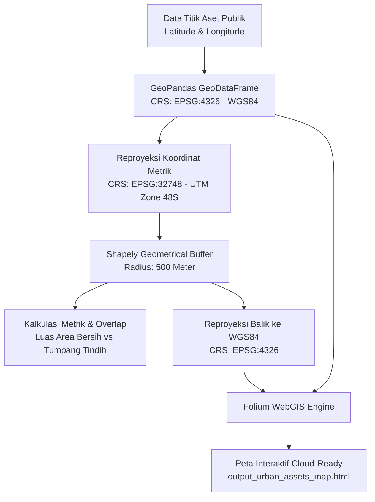

# 🏙️ Smart City Asset Management: Pemetaan & Analisis Buffer Spasial Fasilitas Publik Kota

[](https://www.python.org/)
[](https://geopandas.org/)
[](https://python-visualization.github.io/folium/)
[](https://shapely.readthedocs.io/)
[](LICENSE)

Otomatisasi alur kerja geospasial *open source* untuk manajemen aset fasilitas publik perkotaan (*Smart City Asset Management*), analisis jangkauan layanan (*buffer zone* 500 meter), dan visualisasi peta interaktif WebGIS berbasis *cloud-ready* (`.html`).

---

## 📌 Latar Belakang

Terinspirasi dari implementasi sistem manajemen aset perkotaan modern di Christchurch (*City Care Property*) serta mekanisme partisipatif pelaporan infrastruktur publik warga (*Snap Send Solve*), proyek ini dirancang untuk mengatasi tantangan pemeliharaan aset kota dan optimalisasi jangkauan layanan fasilitas publik.

Dalam konteks perencanaan kota cerdas (*Smart City*), pemerintah daerah dan pengelola fasilitas membutuhkan visibilitas spasial yang presisi:
1. **Pemerataan Akses**: Apakah fasilitas esensial (Puskesmas, RSUD, Sekolah, Ruang Terbuka Hijau, Pos Damkar) menjangkau penduduk dalam radius pejalan kaki (*walkable city* / 500 meter)?
2. **Identifikasi Kesenjangan Layanan (*Service Gap*) & Tumpang Tindih (*Overlap*)**: Mencegah redundansi alokasi anggaran infrastruktur pada titik yang berdekatan dan mengidentifikasi area *blindspot* yang belum terlayani.
3. **Penyebaran Informasi Publik (*Cloud-Ready WebGIS*)**: Memungkinkan pemangku kepentingan dan masyarakat mengakses peta interaktif secara instan tanpa perlu menginstal software desktop GIS (seperti ArcGIS/QGIS).

---

## 🎯 Tujuan Proyek

- **Spatial Data Ingestion**: Memproses koordinat titik aset perkotaan (*latitude* dan *longitude*) ke dalam struktur data spasial standar `GeoDataFrame` dengan koordinat referensi WGS 84 (`EPSG:4326`).
- **Geodesic Metric Buffer Analytics**: Melakukan reproyeksi ke sistem koordinat proyeksi metrik **UTM Zone 48S (`EPSG:32748`)** untuk menghasilkan buffer radius 500 meter yang akurat secara metrik bebas distorsi derajat.
- **Dissolved Coverage & Overlap Calculation**: Menghitung luas akumulatif, luas jangkauan efektif bersih (*dissolved union*), serta area tumpang tindih antarfasilitas.
- **Interactive WebGIS Deployment**: Mengekspor peta interaktif mandiri (*standalone HTML*) kaya fitur dengan *layer control*, pengukuran jarak (*measure tool*), *minimap*, *fullscreen*, dan styling adaptif per kategori.

---

## 🏗️ Arsitektur & Alur Kerja Pipeline



---

## 🔬 Metodologi Geospasial

### 1. Transformasi Sistem Referensi Koordinat (CRS)
Data GPS/koordinat global menggunakan **EPSG:4326 (WGS 84)** dengan satuan derajat busur (*decimal degrees*). Pada garis lintang khatulistiwa, 1 derajat setara ~111 km, namun semakin mendekati kutub nilai ini mengalami distorsi geodesi.

Untuk menghitung radius jangkauan layanan secara tepat 500 meter, geometri ditransformasikan ke **Sistem Koordinat Proyeksi Universal Transverse Mercator (UTM Zone 48S / EPSG:32748)** yang mencakup wilayah Bengkulu dan Sumatera Bagian Selatan dengan satuan meter.

$$\text{Radius Buffer} = 500 \text{ meter} \implies \text{Luas per Titik} = \pi r^2 \approx \pi \times (500)^2 \approx 785.398\text{ m}^2 \ (\approx 78,54\text{ Ha})$$

### 2. Analisis Cakupan Bersih vs Tumpang Tindih (*Overlap*)
- **Total Area Kumulatif**: $\sum \text{Area}_i$
- **Cakupan Efektif (*Union/Dissolved*)**: $\text{Area}(\bigcup_{i=1}^n \text{Buffer}_i)$
- **Area Redundan (*Overlap*)**: $\sum \text{Area}_i - \text{Area}(\bigcup_{i=1}^n \text{Buffer}_i)$

---

## 📁 Struktur Repositori

```
├── data/
│   └── urban_assets.csv            # Dataset titik fasilitas publik Kota Bengkulu
├── src/
│   ├── __init__.py                 # Inisialisasi package
│   └── spatial_analysis.py         # Implementasi inti pipeline analisis spasial & Folium
├── tests/
│   └── test_spatial_analysis.py    # Unit tests otomatisasi verifikasi fungsi spasial
├── output_urban_assets_map.html    # Output peta WebGIS interaktif (demo 3 aset)
├── output_urban_assets_comprehensive.html # Output peta WebGIS komprehensif (10 aset)
├── run_pipeline.py                 # Script runner eksekusi pipeline
├── requirements.txt                # Daftar dependensi Python
├── .gitignore                      # Konfigurasi file yang diabaikan git
├── LICENSE                         # Lisensi Open Source (MIT)
└── README.md                       # Dokumentasi teknis lengkap
```

---

## 🚀 Panduan Instalasi & Penggunaan

### 1. Kloning Repositori
```bash
git clone https://github.com/MuhammadFadliRahmansyahG1A023005/Smart-City-Asset-Management.git
cd Smart-City-Asset-Management
```

### 2. Buat Virtual Environment & Install Dependensi
```bash
python -m venv venv
# Windows:
venv\Scripts\activate
# Linux/macOS:
source venv/bin/activate

pip install -r requirements.txt
```

### 3. Menjalankan Analisis & WebGIS Builder
Eksekusi script runner utama:
```bash
python run_pipeline.py
```

Atau jalankan modul dengan argumen kustom melalui CLI:
```bash
# Menjalankan dengan radius buffer 750 meter dan file CSV kustom:
python src/spatial_analysis.py --data data/urban_assets.csv --buffer 750 --output peta_750m.html
```

### 4. Menjalankan Unit Tests
```bash
python -m unittest discover -s tests
```

---

## 📊 Hasil Analisis Spasial (Studi Kasus: Kota Bengkulu)

| Parameter | Data Bawaan (3 Titik Inti) | Dataset Lengkap (10 Titik Fasilitas) |
| :--- | :--- | :--- |
| **Aset Terdaftar** | Taman Kota, RSUD M. Yunus, SMAN 1 | RSUD, Sekolah, Kantor Walikota, Damkar, Wisata, dll |
| **Radius Layanan** | 500.0 meter | 500.0 meter |
| **Akumulasi Area** | 2.352 km² | 7.841 km² |
| **Cakupan Bersih (*Dissolved*)** | 2.233 km² | 7.205 km² |
| **Area Tumpang Tindih (*Overlap*)** | 0.120 km² (~5.1%) | 0.637 km² (~8.1%) |
| **Format Output** | WebGIS Standalone HTML | WebGIS Standalone HTML |

---

## 🗺️ Fitur Peta Interaktif WebGIS

Peta keluaran HTML menyertakan fitur modern kelas enterprise:
- **Layer Control**: Pengguna dapat mengaktifkan/menonaktifkan layer jangkauan buffer dan titik aset secara terpisah.
- **Multi-Basemap Switching**: Pilihan peta dasar OpenStreetMap, Satelit resolusi tinggi (*Esri World Imagery*), dan Topografi (*OpenTopoMap*).
- **Responsive Popup Card**: Kartu detail informasi aset lengkap dengan badge kategori, ID aset, koordinat GPS, dan radius layanan.
- **Dynamic Tooltips & Color-Coding**: Pewarnaan khusus per sektor (Merah: Kesehatan, Biru: Pendidikan, Hijau: Fasilitas Publik, dll).
- **Interactive GIS Tools**: Pengukur jarak/keliling (*Measure Control*), *Minimap Overview*, dan mode layar penuh (*Fullscreen*).

---

## 📄 Lisensi

Proyek ini didistribusikan di bawah lisensi **MIT License**. Lihat file [LICENSE](LICENSE) untuk informasi lebih lanjut.
